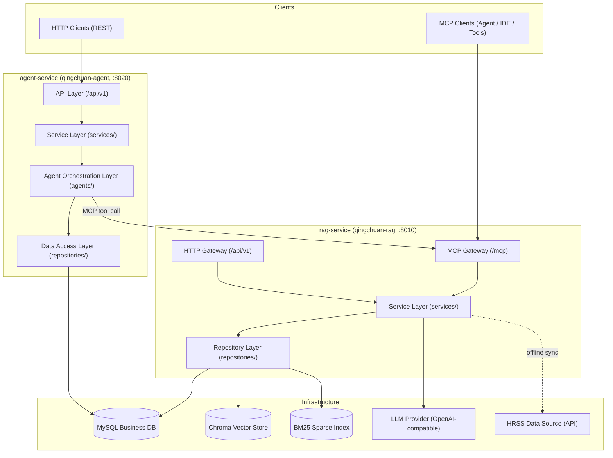
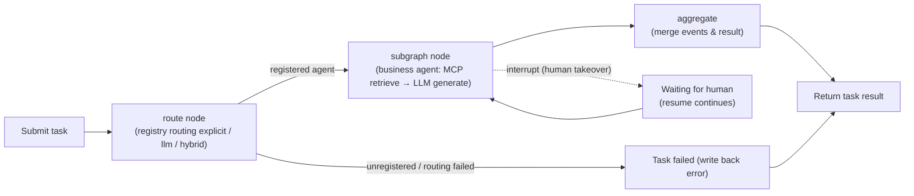
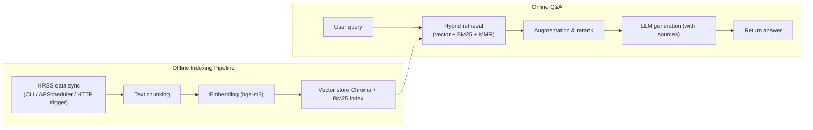

# QingChuan（晴川）

HRSS data offline indexing + RAG (Retrieval-Augmented Generation) + a human-interactive multi-agent orchestration platform (Phase 1 currently focuses on intelligent Q&A).
Make government-domain knowledge searchable, answerable and orchestratable — built on HRSS data, exposed via dual-protocol (HTTP + MCP) services, and scheduled by LangGraph multi-agent orchestration.


[中文](README.md) | English

## 💡 Project Introduction

QingChuan is a **data offline indexing + RAG retrieval-augmented generation + human-interactive multi-agent orchestration platform** for HRSS (Human Resources & Social Security) business scenarios (Phase 1 currently focuses on intelligent Q&A). It is structured as a uv monorepo with two independently deployable services and two shared packages:

- **rag-service（qingchuan-rag）**: an integrated service platform of HRSS data offline indexing + RAG (Retrieval-Augmented Generation), exposing **HTTP + MCP dual protocols**; the offline indexing pipeline (CLI + APScheduler scheduled tasks) ships with the service;
- **agent-service（qingchuan-agent）**: a **human-interactive multi-agent orchestration platform** (LangGraph orchestration runtime + HTTP service); the top-level orchestration graph runs `route → subagent → aggregate`, and new agents register under `agents/` to extend; it calls rag-service via MCP tools and holds no index-write permission;
- **packages/domain（qingchuan-domain）**: single source of truth for entities / schemas / retrieval protocols / ports, referenced directly by both services;
- **packages/common（qingchuan-common）**: cross-service shared components (MCP client wrapper / auth / audit / observability, placeholder).

**Current status**: Phase 1 focuses on intelligent Q&A — the RAG retrieval & Q&A chain runs end-to-end (HRSS sync supports mock integration and the Agent A Q&A chain is closed loop); the Agent orchestration skeleton is delivered (new business agents extend via registration), and task/event persistence is disabled by default so the service can start without a database.

## 🚀 Quick Start

### 🖥️ rag-service (HRSS data offline indexing + RAG integrated service)

```bash
cd apps/rag-service
uv run qingchuan-rag-api
```

Access <http://127.0.0.1:8010> (MCP mounted at /mcp). See [rag-service/README.en.md](apps/rag-service/README.en.md).

### 🤖 agent-service (human-interactive multi-agent orchestration platform)

```bash
cd apps/agent-service
uv run qingchuan-agent-api
```

Access <http://127.0.0.1:8020>. See [agent-service/README.en.md](apps/agent-service/README.en.md).

> **Docker deployment**: `docker compose up -d --build` orchestrates MySQL, Redis, rag-service and agent-service (internal network only). For Aliyun production deployment (co-existing with x-HanJiang on the same host), see [DEPLOY.md](DEPLOY.md).

## 📁 Project Structure

```text
x-QingChuan/
├── apps/
│   ├── agent-service/                  # Human-interactive multi-agent orchestration platform (standalone, :8020)
│   │   ├── src/qingchuan_agent/
│   │   │   ├── main.py                 # FastAPI entry (lifespan / middleware / exceptions / routes)
│   │   │   ├── cli.py                  # CLI: qingchuan-agent (demo) / qingchuan-agent-api
│   │   │   ├── api/                    # API layer: /api/v1 (health / version / agents / tasks / events)
│   │   │   ├── services/               # Business logic layer (AgentTaskService full lifecycle)
│   │   │   ├── repositories/           # Data access layer (task / event repositories)
│   │   │   ├── models/                 # ORM entities (AgentTask / AgentEvent)
│   │   │   ├── schemas/                # Request/response schemas (ApiResponse / Page wrappers)
│   │   │   ├── agents/                 # Orchestration layer: orchestrator / registry / runtime / base / state / routing / tools
│   │   │   ├── infras/                 # Infrastructure (MySQL Provider / LLM Provider / event bus)
│   │   │   ├── core/                   # Core infrastructure (config / logger / exceptions / middleware)
│   │   │   ├── constants/              # Constants & enums package
│   │   │   ├── templates/              # Prompt templates (LLM routing prompts)
│   │   │   └── utils/                  # Utilities (IP extraction / masking)
│   │   ├── Dockerfile
│   │   └── pyproject.toml              # qingchuan-agent
│   └── rag-service/                    # HRSS data offline indexing + RAG integrated service platform (standalone, :8010)
│       ├── src/qingchuan_rag/
│       │   ├── main.py                 # FastAPI entry (HTTP routes + /mcp Streamable HTTP)
│       │   ├── cli.py                  # CLI: qingchuan-rag-api / qingchuan-pipeline
│       │   ├── http_server/            # HTTP gateway (v1: health / rag / document / sync / audit_log)
│       │   ├── mcp_server/             # MCP gateway (server / tools / prompts / resources)
│       │   ├── sync/                   # HRSS data sync (scheduler / sync_service)
│       │   ├── services/               # Business services (document / rag / sync / retrieval_adapter / audit)
│       │   ├── repositories/           # Data repositories (document / vector / bm25 / sync_task / audit_log)
│       │   ├── rag/                    # RAG pipeline (retrieval / augmentation / generation / pipeline)
│       │   ├── retrieval/              # Hybrid retrieval (vector + BM25)
│       │   ├── infras/                 # Infrastructure (database / vector / embedding / chunking / storage / bm25 / llm / http / hrss)
│       │   ├── models/                 # ORM entities (audit_logs / sync_tasks)
│       │   ├── schemas/                # Request/response schemas
│       │   └── core/                   # Core infrastructure (config / logger / exceptions / middleware)
│       ├── tests/                      # Unit / integration / API tests
│       ├── scripts/                    # HTTP / MCP client scripts (qingchuan_http_client.py / qingchuan_mcp_client.py)
│       ├── data/                       # Runtime data (chroma / bm25 / documents / db)
│       ├── Dockerfile
│       └── pyproject.toml              # qingchuan-rag
├── packages/
│   ├── common/                         # Cross-service shared components (MCP client / auth / audit / observability, placeholder)
│   │   └── src/qingchuan_common/
│   └── domain/                         # Shared domain package (entities / schemas / retrieval protocols / ports, single source of truth)
│       └── src/qingchuan_domain/
├── docker-compose.yml                  # One-command orchestration of rag-service + agent-service
├── pyproject.toml                      # uv workspace root (members: apps/*, packages/*)
├── .env                                # Environment config (not committed)
├── .pre-commit-config.yaml             # pre-commit hooks (ruff)
├── LICENSE                             # MIT License
├── README.md / README.en.md            # Bilingual documentation
└── uv.lock                             # Dependency lockfile
```

## 🏗️ System Architecture

### 🧱 Layered Architecture



### 🔄 Core Business Flows

**Agent orchestration flow (route → subagent → aggregate)**:



**RAG offline sync + online Q&A**:



### 🔩 Key Technical Components

| Module | Component | Description |
| --- | --- | --- |
| Web framework | FastAPI + Uvicorn | HTTP gateway of both services, unified response wrapper & exception handling |
| Agent orchestration | LangGraph | Top-level orchestration graph + nested business subgraphs, interrupt / resume |
| Registration / routing | AgentRegistry | task_type → AgentSpec mapping-table routing, lazy compile cache |
| LLM access | LangChain (OpenAI-compatible) | DeepSeek / Doubao / Aliyun Bailian / Xiaomi MiMo |
| MCP | mcp 2.3+ | rag-service Streamable HTTP (/mcp); agent calls via MCP client |
| Vector retrieval | ChromaDB + sentence-transformers (BAAI/bge-m3) | Dense index, persisted at `data/chroma` |
| Sparse retrieval | rank-bm25 | BM25 index, hybrid with vector retrieval |
| Business DB | SQLAlchemy 2 + PyMySQL (MySQL 8) | Audit logs / sync tasks / Agent tasks & events |
| Scheduling | APScheduler | HRSS sync cron (default 03:00 daily) |
| Config | pydantic-settings / pydantic + PyYAML | Segmented prefixed config; invalid config blocks startup |
| Logging | loguru | Colored console / file rotation (1 day / keep 7 days) |
| Engineering | uv + ruff + pre-commit + pytest | Workspace deps, static checks, tests |
| Deployment | Docker Compose | One-command orchestration of rag-service + agent-service |

## 🛠️ Technology Stack

| Category | Choice |
| --- | --- |
| Language | Python 3.12+ |
| Web framework | FastAPI 0.115+ / Uvicorn 0.30+ |
| Agent orchestration | LangGraph 0.2+ (top-level graph + business subgraphs, interrupt / resume) |
| LLM access | LangChain (langchain-core 0.3+ / langchain-openai 0.2+, OpenAI-compatible protocol) |
| MCP | mcp 2.3+ (Streamable HTTP) |
| Vector database | ChromaDB 0.4+ |
| Embedding | sentence-transformers (BAAI/bge-m3) |
| Sparse retrieval | rank-bm25 0.2+ |
| Business database | MySQL 8.0 (SQLAlchemy 2 + PyMySQL; SQLite for local) |
| Scheduling | APScheduler 3.10+ |
| Config management | pydantic-settings 2.5+ / pydantic 2.9+ / PyYAML |
| Logging | loguru 0.7+ |
| Package management | uv (workspace: apps/* + packages/*, uv.lock) |
| Engineering | ruff + pre-commit + pytest (pytest-asyncio / pytest-cov) |
| Deployment | Docker / Docker Compose |

## 📄 License

[MIT License](LICENSE) © 2026 ChainEngine

## 📮 Contact

- **Author**: John Young（夜雨诗来）
- **Email**: john.young@foxmail.com
- **Gitee**: <https://gitee.com/yeyushilai>
- **GitHub**: <https://github.com/yeyushilai>
- **Project**: <https://github.com/chain-engine/x-QingChuan>
