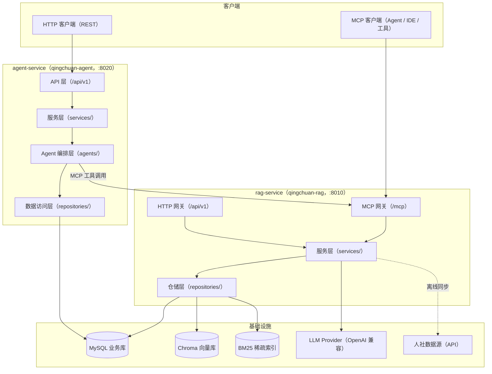
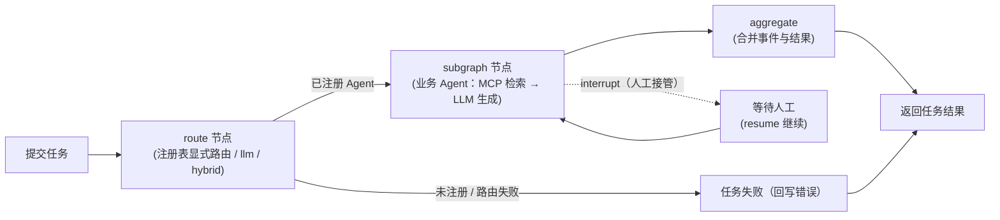

# 晴川（QingChuan）

人社（HRSS）数据离线索引 + RAG（检索增强生成） + 人机交互的多 Agent 编排平台（当前第一期聚焦智能问答）。
让政务领域知识可检索、可问答、可编排 —— 基于人社数据，通过 HTTP + MCP 双协议服务对外暴露，由 LangGraph 多智能体编排调度。

[English](README.en.md) | 中文


## 💡 项目介绍

晴川是一个面向**人社（HRSS）业务场景**的 **数据离线索引 + RAG 检索增强生成 + 人机交互多 Agent 编排平台**（当前第一期聚焦智能问答）。工程采用 uv monorepo 结构，包含两个可独立部署的服务与两个共享包：

- **rag-service（qingchuan-rag）**：人社（HRSS）数据离线索引 + RAG（检索增强生成）一体化服务平台，对外暴露 **HTTP + MCP 双协议**；离线索引流水线（CLI + APScheduler 周期任务）随服务内置；
- **agent-service（qingchuan-agent）**：**人机交互的多智能体编排平台**（LangGraph 编排运行时 + HTTP 服务）；顶层编排图执行 `route → subagent → aggregate`，新 Agent 在 `agents/` 目录注册即可扩展；经 MCP 工具调用 rag-service，不持有索引写权限；
- **packages/domain（qingchuan-domain）**：实体 / Schema / 检索协议 / 端口的唯一事实来源，两个服务直接引用；
- **packages/common（qingchuan-common）**：跨服务共享组件（MCP 客户端封装 / 认证 / 审计 / 可观测性，占位）。

**当前状态**：第一期聚焦智能问答——RAG 检索问答链路已端到端跑通（人社同步支持 mock 数据联调，Agent A 问答链路已闭环）；Agent 编排骨架已交付（新业务 Agent 注册即可扩展），任务 / 事件持久化默认关闭，无数据库也可启动服务。

## 🚀 快速开始

### 🖥️ rag-service（人社数据离线索引 + RAG 一体化服务）

```bash
cd apps/rag-service
uv run qingchuan-rag-api
```

访问 <http://127.0.0.1:8010>（MCP 挂载于 /mcp），详见 [rag-service/README.md](apps/rag-service/README.md)。

### 🤖 agent-service（人机交互多智能体编排平台）

```bash
cd apps/agent-service
uv run qingchuan-agent-api
```

访问 <http://127.0.0.1:8020>，详见 [agent-service/README.md](apps/agent-service/README.md)。

> **Docker 一键部署**：`docker compose up --build`；环境要求、依赖同步（`uv sync --all-packages`）、环境配置等详细步骤，见上述各服务 README。

## 📁 项目结构

```text
x-QingChuan/
├── apps/
│   ├── agent-service/                  # 人机交互多智能体编排平台（独立部署，:8020）
│   │   ├── src/qingchuan_agent/
│   │   │   ├── main.py                 # FastAPI 入口（lifespan / 中间件 / 异常 / 路由）
│   │   │   ├── cli.py                  # CLI：qingchuan-agent（演示）/ qingchuan-agent-api
│   │   │   ├── api/                    # API 层：/api/v1（health / version / agents / tasks / events）
│   │   │   ├── services/               # 业务逻辑层（AgentTaskService 全生命周期）
│   │   │   ├── repositories/           # 数据访问层（任务 / 事件仓储）
│   │   │   ├── models/                 # ORM 实体（AgentTask / AgentEvent）
│   │   │   ├── schemas/                # 请求 / 响应 Schema（ApiResponse / Page 包装）
│   │   │   ├── agents/                 # 编排层：orchestrator / registry / runtime / base / state / routing / tools
│   │   │   ├── infras/                 # 基础设施（MySQL Provider / LLM Provider / 事件总线）
│   │   │   ├── core/                   # 核心基础设施（config / logger / exceptions / middleware）
│   │   │   ├── constants/              # 常量与枚举包
│   │   │   ├── templates/              # Prompt 模板（LLM 路由提示词）
│   │   │   └── utils/                  # 工具（IP 提取 / 掩码）
│   │   ├── Dockerfile
│   │   └── pyproject.toml              # qingchuan-agent
│   └── rag-service/                    # 人社数据离线索引 + RAG 一体化服务平台（独立部署，:8010）
│       ├── src/qingchuan_rag/
│       │   ├── main.py                 # FastAPI 入口（HTTP 路由 + /mcp Streamable HTTP）
│       │   ├── cli.py                  # CLI：qingchuan-rag-api / qingchuan-pipeline
│       │   ├── http_server/            # HTTP 网关（v1：health / rag / document / sync / audit）
│       │   ├── mcp_server/             # MCP 网关（server / tools / prompts / resources）
│       │   ├── sync/                   # 人社数据同步（scheduler 调度器 / sync_service 同步服务）
│       │   ├── services/               # 业务服务（document / rag / sync / retrieval_adapter / audit）
│       │   ├── repositories/           # 数据仓储（document / vector / bm25 / sync_task / audit_log）
│       │   ├── rag/                    # RAG 流水线（retrieval / augmentation / generation / pipeline）
│       │   ├── retrieval/              # 混合检索（candidate 召回 + ranking 重排 + understanding 理解）
│       │   ├── infras/                 # 基础设施（database / vector / embedding / chunking / storage / bm25 / llm / http / hrss）
│       │   ├── models/                 # ORM 实体（audit_logs / sync_tasks）
│       │   ├── schemas/                # 请求 / 响应 Schema
│       │   └── core/                   # 核心基础设施（config / logger / exceptions / middleware）
│       ├── tests/                      # 单元 / 集成 / API 测试
│       ├── scripts/                    # HTTP / MCP 客户端脚本（qingchuan_http_client.py / qingchuan_mcp_client.py）
│       ├── data/                       # 运行数据（chroma / bm25 / documents / db）
│       ├── Dockerfile
│       └── pyproject.toml              # qingchuan-rag
├── packages/
│   ├── common/                         # 跨服务共享组件（MCP 客户端 / 认证 / 审计 / 可观测性，占位）
│   │   └── src/qingchuan_common/
│   └── domain/                         # 共享领域包（实体 / Schema / 检索协议 / 端口，唯一事实来源）
│       └── src/qingchuan_domain/
├── docker-compose.yml                  # 一键编排 rag-service + agent-service
├── pyproject.toml                      # uv 工作区根（members：apps/*、packages/*）
├── .env                                # 环境配置（不入库）
├── .pre-commit-config.yaml             # pre-commit 钩子（ruff）
├── LICENSE                             # MIT 许可证
├── README.md / README.en.md            # 中英双语文档
└── uv.lock                             # 依赖锁文件
```

## 🏗️ 系统架构

### 🧱 分层架构



### 🔄 核心业务流程

**Agent 编排流程（route → subagent → aggregate）**：



**RAG 离线同步 + 在线问答**：


### 🔩 关键技术组件

| 模块 | 组件 | 说明 |
| --- | --- | --- |
| Web 框架 | FastAPI + Uvicorn | 两个服务的 HTTP 网关，统一响应包装与异常处理 |
| Agent 编排 | LangGraph | 顶层编排图 + 嵌套业务子图，interrupt / resume |
| 注册 / 路由 | AgentRegistry | task_type → AgentSpec 映射表路由，惰性编译缓存 |
| LLM 接入 | LangChain（OpenAI 兼容） | DeepSeek / 豆包 / 阿里云百炼 / 小米 MiMo |
| MCP | mcp 2.3+ | rag-service Streamable HTTP（/mcp）；agent 经 MCP 客户端调用 |
| 向量检索 | ChromaDB + sentence-transformers（BAAI/bge-m3） | 稠密索引，持久化于 `data/chroma` |
| 稀疏检索 | rank-bm25 | BM25 索引，与向量检索混合 |
| 业务库 | SQLAlchemy 2 + PyMySQL（MySQL 8） | 审计日志 / 同步任务 / Agent 任务与事件 |
| 周期调度 | APScheduler | 人社同步 cron（默认每日 03:00） |
| 配置 | pydantic-settings / pydantic + PyYAML | 分段带前缀配置；非法配置阻断启动 |
| 日志 | loguru | 彩色控制台 / 文件轮转（1 天 / 保留 7 天） |
| 工程化 | uv + ruff + pre-commit + pytest | 工作区依赖、静态检查、测试 |
| 部署 | Docker Compose | 一键编排 rag-service + agent-service |

## 🛠️ 技术栈

| 分类 | 选型 |
| --- | --- |
| 开发语言 | Python 3.12+ |
| Web 框架 | FastAPI 0.115+ / Uvicorn 0.30+ |
| Agent 编排 | LangGraph 0.2+（顶层图 + 业务子图，interrupt / resume） |
| LLM 接入 | LangChain（langchain-core 0.3+ / langchain-openai 0.2+，OpenAI 兼容协议） |
| MCP | mcp 2.3+（Streamable HTTP） |
| 向量数据库 | ChromaDB 0.4+ |
| 向量嵌入 | sentence-transformers（BAAI/bge-m3） |
| 稀疏检索 | rank-bm25 0.2+ |
| 业务数据库 | MySQL 8.0（SQLAlchemy 2 + PyMySQL；本地可 SQLite） |
| 周期调度 | APScheduler 3.10+ |
| 配置管理 | pydantic-settings 2.5+ / pydantic 2.9+ / PyYAML |
| 日志 | loguru 0.7+ |
| 包管理 | uv（工作区：apps/* + packages/*，uv.lock） |
| 工程化 | ruff + pre-commit + pytest（pytest-asyncio / pytest-cov） |
| 部署 | Docker / Docker Compose |

## 📄 许可证

[MIT 许可证](LICENSE) © 2026 ChainEngine

## 📮 联系方式

- **作者**：John Young（夜雨诗来）
- **邮箱**：john.young@foxmail.com
- **Gitee**：<https://gitee.com/yeyushilai>
- **GitHub**：<https://github.com/yeyushilai>
- **项目地址**：<https://github.com/chain-engine/x-QingChuan>
