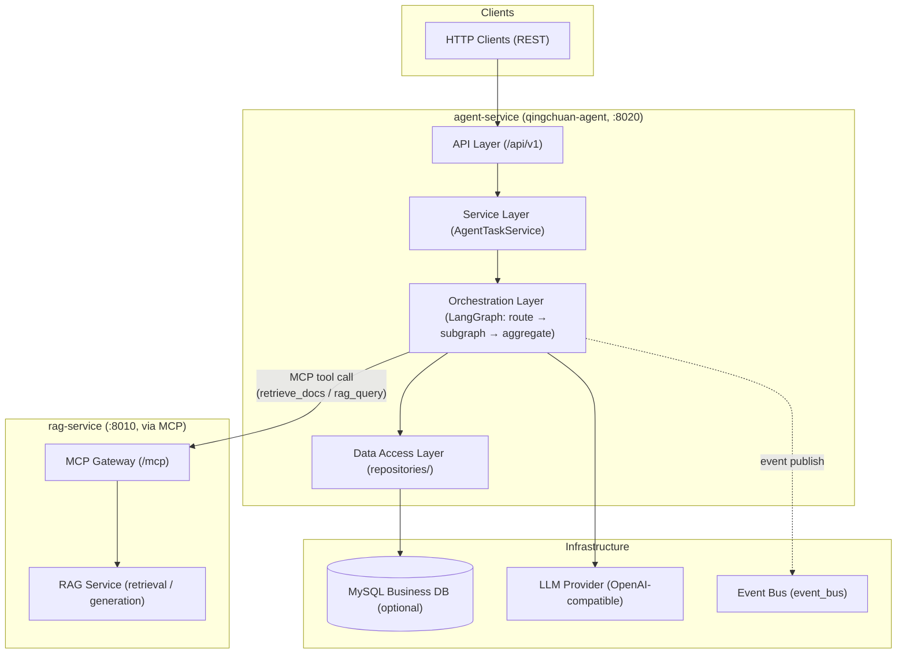
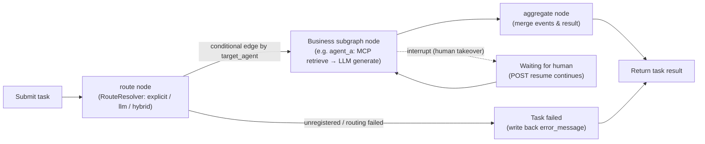
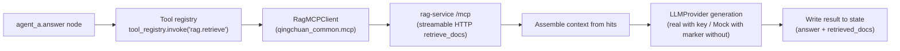

# QingChuan agent-service（qingchuan-agent）

LangGraph multi-agent orchestration runtime + HTTP service.
Dispatch, orchestrate, aggregate — the top-level graph runs `route → subagent → aggregate`, new agents extend via registration, and RAG Q&A is fulfilled by calling rag-service through MCP tools.

[中文](README.md) | English


## 💡 Project Introduction

The **LangGraph multi-agent orchestration runtime + HTTP service** of the QingChuan (x-QingChuan) project, listening on `:8020` by default. Core capabilities:

- **Top-level orchestration graph**: `route → subagent → aggregate` three-layer structure; compiled business subgraphs are automatically mounted as top-level graph nodes — registering a new agent requires no graph changes;
- **Three routing modes**: `explicit` (registry table lookup) / `llm` (natural-language dynamic routing) / `hybrid` (explicit first, LLM fallback), decided by RouteResolver and written to audit fields;
- **Human takeover**: subgraphs support LangGraph `interrupt / resume`; interrupted tasks are resumed through HTTP with a human decision;
- **Calls rag-service via MCP**: connects to rag-service `/mcp` through the `qingchuan_common.mcp` MCP client and calls the `retrieve_docs` / `rag_query` tools; the service itself holds no index-write permission;
- **Task state machine**: submit → route → execute → aggregate → persist / write back, with retries (default 3) and timeout (default 300 s);
- **Optional persistence**: task / event persistence is disabled by default (`QINGCHUAN_AGENT_DATABASE_ENABLED=false`), so the service starts without a database.

**Current status**: orchestration skeleton delivered; Agent A (RAG Q&A) chain is closed loop — `agent_a.answer` → tool registry `rag.retrieve` → rag-service `/mcp` → LLM generation (Mock with a marker when no API key is configured). New business agents extend via registration under `agents/`.

## 🚀 Quick Start

### 🖥️ 1. Prerequisites

- **Windows / Linux / macOS** all supported; Python 3.12+ required;
- **uv** package manager (required for workspace dependency sync): <https://docs.astral.sh/uv/>;
- **Docker / Docker Compose** (needed for container deployment; optional for local development);
- **MySQL 8.0** (only needed for task / event persistence; disabled by default, not required to install);
- **rag-service** (`:8010`) is the retrieval backend for this service; start it first for local integration.

### 📥 2. Clone the Repository

```bash
git clone https://github.com/chain-engine/x-QingChuan.git
cd x-QingChuan/apps/agent-service
```

### 📦 3. Install Dependencies

Run from the repository root:

```bash
uv lock                 # first run: generate the lockfile
uv sync --package qingchuan-agent  # install agent-service and its workspace dependencies only
```

### ⚙️ 4. Environment Configuration

This service reads configuration from the **root `.env` of the repository** (loadable from any CWD), with the environment variable prefix `QINGCHUAN_AGENT_` and segmented, prefixed settings. Key parameters:

| Parameter | Default | Description |
| --- | --- | --- |
| `QINGCHUAN_AGENT_SERVER_HOST` / `QINGCHUAN_AGENT_SERVER_PORT` | `0.0.0.0` / `8020` | HTTP listen address & port |
| `QINGCHUAN_AGENT_SERVER_DEBUG` | `true` | hot reload toggle (must be `false` in production) |
| `QINGCHUAN_AGENT_DATABASE_ENABLED` | `false` | task / event persistence toggle (auto-creates tables on first start) |
| `QINGCHUAN_AGENT_DATABASE_HOST` / `PORT` / `USER` / `PASSWORD` / `DATABASE` | `localhost` / `3306` / `root` / empty / `qingchuan` | MySQL connection parameters (used when persistence is enabled) |
| `QINGCHUAN_AGENT_AGENT_ROUTE_MODE` | `explicit` | routing mode: `explicit` / `llm` / `hybrid` |
| `QINGCHUAN_AGENT_AGENT_CHECKPOINT` | `memory` | checkpoint implementation: `memory` / `redis` (redis required in production) |
| `QINGCHUAN_AGENT_AGENT_CONFIDENCE_THRESHOLD` | `0.7` | confidence threshold for LLM dynamic routing |
| `QINGCHUAN_AGENT_AGENT_TASK_MAX_RETRIES` / `TASK_TIMEOUT_SECONDS` | `3` / `300` | max retries per task / per-task timeout |
| `QINGCHUAN_AGENT_AI_LLM_API_KEY` / `BASE_URL` / `MODEL` | empty / empty / `deepseek-chat` | LLM provider config (Mock when no key is set) |
| `QINGCHUAN_AGENT_RAG_MCP_URL` | `http://rag-service:8010/mcp` | rag-service MCP endpoint (use `http://127.0.0.1:8010/mcp` locally) |
| `QINGCHUAN_AGENT_RAG_HTTP_BASE_URL` | `http://rag-service:8010` | rag HTTP fallback base URL (reserved) |
| `QINGCHUAN_AGENT_LOGGING_LEVEL` | `INFO` | log level (`LOGGING_FILE_PATH` controls file path / rotation) |

> Production (`APP_ENV=production`) enforces validation: DEBUG forbidden, CORS whitelist cannot be `*`, database HOST/DATABASE required when persistence is enabled, checkpoint must be redis — otherwise startup is blocked.

### 🚀 5. Start the Services

**Local development with hot reload** (run inside `apps/agent-service`):

```bash
uv run qingchuan-agent-api                # start the HTTP service (equivalent to uvicorn qingchuan_agent.main:app)
# or directly with uvicorn
uv run uvicorn qingchuan_agent.main:app --reload --host 0.0.0.0 --port 8020

# orchestration runtime skeleton demo (verifies registry / routing / runtime)
uv run qingchuan-agent
```

**Docker container deployment** (run from the repository root):

```bash
docker compose up --build agent-service
```

### 🧪 6. Common Engineering Commands

```bash
uv run ruff check .            # static code check
uv run ruff format .           # code formatting
uv run pytest                  # unit tests
pre-commit run --all-files     # pre-commit hooks (ruff --fix + ruff-format)
uv audit                       # dependency vulnerability scan (built into uv 0.5+)
```

### 💬 7. Usage Examples

**Submit an Agent task (explicit routing)**:

```bash
curl -X POST http://127.0.0.1:8020/api/v1/tasks \
  -H "Content-Type: application/json" \
  -d '{"task_type": "agent_a", "payload": {"query": "How can I check my medical insurance payment records?"}}'
```

**Submit a task (empty task_type → LLM dynamic routing)**:

```bash
curl -X POST http://127.0.0.1:8020/api/v1/tasks \
  -H "Content-Type: application/json" \
  -d '{"payload": {"query": "How can I check my medical insurance payment records?"}}'
```

**Query a task and resume after human takeover**:

```bash
curl http://127.0.0.1:8020/api/v1/tasks/1
curl -X POST http://127.0.0.1:8020/api/v1/tasks/1/resume \
  -H "Content-Type: application/json" \
  -d '{"decision": "approve", "remark": "Human approved, continue execution"}'
```

### ❓ 8. Troubleshooting

| Symptom | Solution |
| --- | --- |
| Port already in use | Change `QINGCHUAN_AGENT_SERVER_PORT` |
| `uv` install fails / times out | Check the network; configure a `[tool.uv.index]` mirror in the workspace root `pyproject.toml` |
| Retrieval returns empty / connection fails | Confirm rag-service is running (`:8010`); use `http://127.0.0.1:8010/mcp` for `QINGCHUAN_AGENT_RAG_MCP_URL` locally |
| Database connection failure | Keep `QINGCHUAN_AGENT_DATABASE_ENABLED=false` to run without a DB, or configure MySQL connection parameters correctly |
| Dynamic routing not working | Confirm `QINGCHUAN_AGENT_AGENT_ROUTE_MODE=llm` or `hybrid` and an LLM API key is configured |
| Startup fails with a config error | Production (`APP_ENV=production`) forbids DEBUG / `*` CORS / memory checkpoint; invalid config blocks startup |

## 📁 Project Structure

```text
apps/agent-service/
├── src/qingchuan_agent/
│   ├── main.py                 # FastAPI entry (lifespan / middleware / exceptions / routes)
│   ├── cli.py                  # CLI: qingchuan-agent (orchestration demo) / qingchuan-agent-api (HTTP)
│   ├── api/                    # API layer (router / dependencies / response; v1: health, agent_task)
│   ├── services/               # Business logic layer (agent_task_service full lifecycle)
│   ├── repositories/           # Data access layer (agent_task / agent_event repositories)
│   ├── models/entities/        # ORM entities (agent_task / agent_event)
│   ├── schemas/                # Request/response schemas (ApiResponse / Page wrappers)
│   ├── agents/                 # Orchestration layer (orchestrator / registry / runtime / base / state / routing / tools / agent_a)
│   ├── infras/                 # Infrastructure (database / llm / rag_mcp / event_bus)
│   ├── core/                   # Core infrastructure (config / logger / exceptions / middleware)
│   ├── constants/              # Constants & enums (routing modes / task status / API prefix)
│   ├── templates/prompts/      # Prompt templates (LLM routing prompts)
│   └── utils/                  # Utilities (IP extraction / masking)
├── scripts/                    # Helper scripts
├── data/                       # Runtime data
├── logs/                       # Log files (loguru rotation)
├── Dockerfile                  # Container image
└── pyproject.toml              # qingchuan-agent (entry points: qingchuan-agent / qingchuan-agent-api)
```

## 🏗️ System Architecture

### 🧱 Layered Architecture



### 🔄 Core Business Flows

**Agent orchestration flow (route → subagent → aggregate)**:



**Agent A (RAG Q&A) subgraph chain**:



### 🔩 Key Technical Components

| Module | Component | Description |
| --- | --- | --- |
| Web framework | FastAPI + Uvicorn | HTTP gateway, unified response wrapper & exception handling |
| Agent orchestration | LangGraph | Top-level orchestration graph + nested business subgraphs; interrupt / resume human takeover |
| Registry / routing | AgentRegistry + RouteResolver | task_type → AgentSpec mapping; explicit / llm / hybrid decision |
| Subgraph extension | BaseAgent + agent_registry.register | implement `build()` and register; subgraphs lazily compiled and auto-mounted |
| MCP client | qingchuan_common.mcp | MCPClient connects to rag-service `/mcp`, calls retrieve_docs / rag_query |
| LLM access | LangChain ChatOpenAI | OpenAI-compatible protocol; Mock when no key is set |
| Task state machine | AgentTaskService | submit → route → execute → aggregate → persist / write back; retry / timeout / interrupt resume |
| Business DB | SQLAlchemy 2 + PyMySQL (MySQL 8) | agent_tasks / agent_events (disabled by default) |
| Config | pydantic-settings | Segmented prefixed config; invalid config blocks startup; production validation |
| Logging | loguru | Colored console / file rotation (1 day / keep 7 days / zip compression) |
| Engineering | uv + ruff + pre-commit + pytest | Workspace deps, static checks, tests |

## 🛠️ Technology Stack

| Category | Choice |
| --- | --- |
| Language | Python 3.12+ |
| Web framework | FastAPI 0.115+ / Uvicorn 0.30+ |
| Agent orchestration | LangGraph 0.2+ (top-level graph + business subgraphs, interrupt / resume) |
| LLM access | langchain-core 0.3+ / langchain-openai 0.2+ (OpenAI-compatible protocol) |
| MCP | mcp 2.3+ (client wrapped via qingchuan_common) |
| Business database | MySQL 8.0 (SQLAlchemy 2 + PyMySQL; optional, disabled by default) |
| Config management | pydantic-settings 2.5+ |
| Logging | loguru 0.7+ |
| Package management | uv (workspace members qingchuan-agent / qingchuan-domain / qingchuan-common) |
| Engineering | ruff + pre-commit + pytest |
| Deployment | Docker / Docker Compose |

## 📡 API Documentation

The service enables **Swagger interactive docs / ReDoc read-only docs / OpenAPI JSON**:

| Documentation | URL |
| --- | --- |
| Swagger | <http://127.0.0.1:8020/docs> |
| ReDoc | <http://127.0.0.1:8020/redoc> |
| OpenAPI JSON | <http://127.0.0.1:8020/openapi.json> |

### 📋 Core API List (/api/v1, 9 endpoints)

| Method | Path | Description |
| --- | --- | --- |
| GET | `/api/v1/health` | Health check (incl. DB / Agent runtime status) |
| GET | `/api/v1/version` | Application version info |
| GET | `/api/v1/agents/specs` | Registered agent specs (no database required) |
| POST | `/api/v1/tasks` | Submit an Agent task (explicit task_type routes directly; empty → LLM dynamic routing) |
| GET | `/api/v1/tasks` | Task list (paginated, filter by status / type) |
| GET | `/api/v1/tasks/{task_id}` | Task detail |
| POST | `/api/v1/tasks/{task_id}/resume` | Human takeover: resume an interrupted task (decision / remark / extra) |
| GET | `/api/v1/events` | Collaboration event list (paginated, filter by type) |
| GET | `/api/v1/events/{event_id}` | Collaboration event detail |

### 🔐 Permission & Access Control

- **Tool center principle**: read-only tools (MCP retrieval) are directly callable; write operations require human execution; agent-service itself holds no index-write permission on rag-service;
- **Task routing**: explicit / llm / hybrid modes; routing decisions (mode / confidence / reason) are written to state for audit;
- **Production validation** (`APP_ENV=production`): DEBUG forbidden, CORS whitelist cannot be `*`, connection parameters required when persistence is enabled, checkpoint must be redis — any violation blocks startup.

## 💾 Storage Configuration

| Storage | Purpose | Config parameters | Notes |
| --- | --- | --- | --- |
| MySQL 8.0 | Agent task / collaboration event persistence | `QINGCHUAN_AGENT_DATABASE_ENABLED` / `QINGCHUAN_AGENT_DATABASE_HOST` / `PORT` / `USER` / `PASSWORD` / `DATABASE` | Disabled by default, starts without a DB; auto-creates tables on first start when enabled |
| Log files | loguru file rotation | `QINGCHUAN_AGENT_LOGGING_FILE_PATH` / `LOG_ROTATION=1 day` / `LOG_RETENTION=7 days` | Rotation 1 day / retention 7 days / zip compression |

Data structure definitions (ORM entities):

- `agent_tasks`: task_type / payload / status / result / error_message / assignee_agent / thread_id / retry_count / max_retries / created_at / updated_at;
- `agent_events`: event_type / payload / source_agent / target_agent / status / created_at.

## 📄 License

[MIT License](../LICENSE) © 2026 ChainEngine

## 📚 References

- Python: <https://www.python.org/>
- uv: <https://docs.astral.sh/uv/>
- FastAPI: <https://fastapi.tiangolo.com/>
- Uvicorn: <https://www.uvicorn.org/>
- LangGraph: <https://langchain-ai.github.io/langgraph/>
- LangChain: <https://python.langchain.com/>
- MCP (Model Context Protocol): <https://modelcontextprotocol.io/>
- SQLAlchemy: <https://www.sqlalchemy.org/>
- PyMySQL: <https://pymysql.readthedocs.io/>
- pydantic-settings: <https://docs.pydantic.dev/latest/concepts/pydantic_settings/>
- loguru: <https://loguru.readthedocs.io/>
- Docker: <https://docs.docker.com/>

## 📮 Contact

- **Author**: John Young（夜雨诗来）
- **Email**: john.young@foxmail.com
- **Gitee**: <https://gitee.com/yeyushilai>
- **GitHub**: <https://github.com/yeyushilai>
- **Project**: <https://github.com/chain-engine/x-QingChuan>
