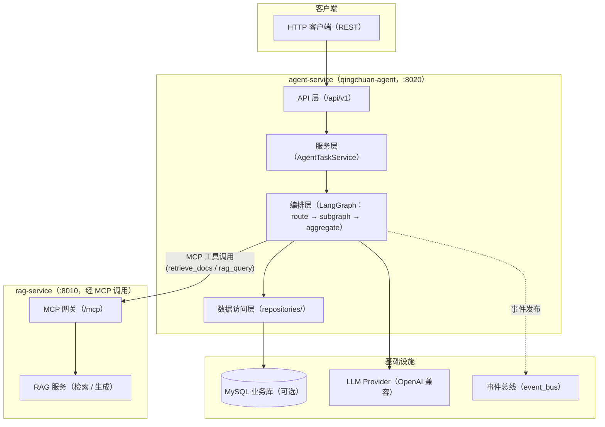
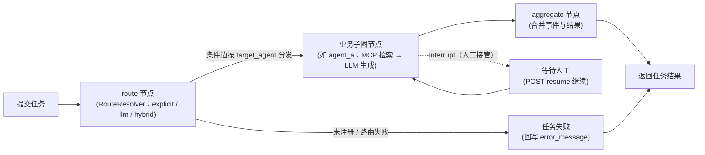
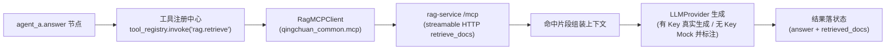

# 晴川 agent-service（qingchuan-agent）

人机交互的多智能体编排平台。
派活、编排、聚合 —— 顶层编排图执行 `route → subagent → aggregate`，新 Agent 注册即可扩展，经 MCP 工具调用 rag-service 完成检索问答。

[English](README.en.md) | 中文


## 💡 项目介绍

晴川（x-QingChuan）项目的 **人机交互的多智能体编排平台**（LangGraph 编排运行时 + HTTP 服务），默认监听 `:8020`，核心能力：

- **顶层编排图**：`route → subagent → aggregate` 三层结构；编译后的业务子图自动挂载为顶层图节点，新增 Agent 注册后无需改动图结构；
- **三种路由模式**：`explicit`（注册表显式查表）/ `llm`（自然语言动态路由）/ `hybrid`（显式优先、LLM 兜底），由 RouteResolver 统一决策并落审计字段；
- **人工接管**：子图支持 LangGraph `interrupt / resume`，任务被中断后经 HTTP 接口人工决策恢复；
- **MCP 调用 rag-service**：经 `qingchuan_common.mcp` MCP 客户端调用 rag-service `/mcp` 的 `retrieve_docs` / `rag_query` 工具，服务本身不持有索引写权限；
- **任务状态机**：提交 → 路由 → 执行 → 聚合 → 落库 / 回写，支持重试（默认 3 次）与超时（默认 300 秒）；
- **持久化可选**：任务 / 事件持久化默认关闭（`QINGCHUAN_AGENT_DATABASE_ENABLED=false`），无数据库也可启动。

**当前状态**：编排骨架已交付；Agent A（RAG 问答）链路已闭环 —— `agent_a.answer` → 工具注册中心 `rag.retrieve` → rag-service `/mcp` → LLM 生成（未配 Key 时走 Mock 并标注）。新业务 Agent 在 `agents/` 目录注册即可扩展。

## 🚀 快速开始

### 🖥️ 1. 环境要求

- **Windows / Linux / macOS** 全平台支持；需要 Python 3.12+；
- **uv** 包管理器（工作区依赖同步必需）：<https://docs.astral.sh/uv/>；
- **Docker / Docker Compose**（容器部署需要；本地开发可选用）；
- **MySQL 8.0**（仅任务 / 事件持久化需要；默认关闭，可不装）；
- **rag-service**（`:8010`）为本服务的检索后端，本地联调需先启动。

### 📥 2. 项目代码克隆

```bash
git clone https://github.com/chain-engine/x-QingChuan.git
cd x-QingChuan/apps/agent-service
```

### 📦 3. 依赖同步安装

在仓库根目录执行：

```bash
uv lock                 # 首次运行：生成锁文件
uv sync --package qingchuan-agent  # 仅安装 agent-service 及其工作区依赖
```

### ⚙️ 4. 环境配置

本服务配置来源为**仓库根目录的 `.env`**（任意 CWD 启动均可加载），环境变量前缀 `QINGCHUAN_AGENT_`，分段配置独立前缀。核心参数：

| 参数 | 默认值 | 说明 |
| --- | --- | --- |
| `QINGCHUAN_AGENT_SERVER_HOST` / `QINGCHUAN_AGENT_SERVER_PORT` | `0.0.0.0` / `8020` | HTTP 监听地址与端口 |
| `QINGCHUAN_AGENT_SERVER_DEBUG` | `true` | 热重载开关（生产必须 `false`） |
| `QINGCHUAN_AGENT_DATABASE_ENABLED` | `false` | 任务 / 事件持久化开关（首次启动自动建表） |
| `QINGCHUAN_AGENT_DATABASE_HOST` / `PORT` / `USER` / `PASSWORD` / `DATABASE` | `localhost` / `3306` / `root` / 空 / `qingchuan` | MySQL 连接参数（启用持久化时生效） |
| `QINGCHUAN_AGENT_AGENT_ROUTE_MODE` | `explicit` | 路由模式：`explicit` / `llm` / `hybrid` |
| `QINGCHUAN_AGENT_AGENT_CHECKPOINT` | `memory` | 检查点实现：`memory` / `redis`（生产必须 redis） |
| `QINGCHUAN_AGENT_AGENT_CONFIDENCE_THRESHOLD` | `0.7` | LLM 动态路由采信阈值 |
| `QINGCHUAN_AGENT_AGENT_TASK_MAX_RETRIES` / `TASK_TIMEOUT_SECONDS` | `3` / `300` | 任务重试上限 / 单任务超时 |
| `QINGCHUAN_AGENT_AI_LLM_API_KEY` / `BASE_URL` / `MODEL` | 空 / 空 / `deepseek-chat` | LLM 供应商配置（未配 Key 走 Mock） |
| `QINGCHUAN_AGENT_RAG_MCP_URL` | `http://rag-service:8010/mcp` | rag-service MCP 端点（本地用 `http://127.0.0.1:8010/mcp`） |
| `QINGCHUAN_AGENT_RAG_HTTP_BASE_URL` | `http://rag-service:8010` | rag HTTP 兜底地址（预留） |
| `QINGCHUAN_AGENT_CORS_ENABLED` / `QINGCHUAN_AGENT_CORS_ORIGINS` / `QINGCHUAN_AGENT_CORS_ALLOW_CREDENTIALS` | `true` / `*` / `true` | 跨域开关、允许来源与凭证；生产环境禁止 `*`（与 rag-service 行为一致） |
| `QINGCHUAN_AGENT_LOGGING_LEVEL` | `INFO` | 日志级别（`LOGGING_FILE_PATH` 控制文件路径 / 轮转） |

> 生产环境（`APP_ENV=production`）强制校验：禁止 DEBUG、CORS 白名单不能为 `*`、启用数据库时必须配置 HOST/DATABASE、checkpoint 必须为 redis，否则直接阻断启动。

### 🚀 5. 服务启动

**本地开发热重载启动**（在 `apps/agent-service` 目录执行）：

```bash
uv run qingchuan-agent-api                # 启动 HTTP 服务（等价 uvicorn qingchuan_agent.main:app）
# 或直接使用 uvicorn
uv run uvicorn qingchuan_agent.main:app --reload --host 0.0.0.0 --port 8020

# 编排运行时骨架演示（验证注册表 / 路由 / 运行时）
uv run qingchuan-agent
```

**Docker 容器部署**（仓库根目录执行）：

```bash
docker compose up --build agent-service
```

### 🧪 6. 常用工程命令

```bash
uv run ruff check .            # 静态代码检查
uv run ruff format .           # 代码格式化
uv run pytest                  # 单元测试
pre-commit run --all-files     # pre-commit 钩子（ruff --fix + ruff-format）
uv audit                       # 依赖漏洞扫描（uv 0.5+ 内置）
```

### 💬 7. 使用方法示例

**提交 Agent 任务（显式路由）**：

```bash
curl -X POST http://127.0.0.1:8020/api/v1/tasks \
  -H "Content-Type: application/json" \
  -d '{"task_type": "agent_a", "payload": {"query": "医保缴费记录如何查询？"}}'
```

**提交任务（留空 → LLM 动态路由）**：

```bash
curl -X POST http://127.0.0.1:8020/api/v1/tasks \
  -H "Content-Type: application/json" \
  -d '{"payload": {"query": "医保缴费记录如何查询？"}}'
```

**查询任务与恢复人工接管**：

```bash
curl http://127.0.0.1:8020/api/v1/tasks/1
curl -X POST http://127.0.0.1:8020/api/v1/tasks/1/resume \
  -H "Content-Type: application/json" \
  -d '{"decision": "approve", "remark": "人工确认继续执行"}'
```

### ❓ 8. 常见问题排查

| 症状 | 解决方案 |
| --- | --- |
| 端口被占用 | 修改 `QINGCHUAN_AGENT_SERVER_PORT` |
| `uv` 安装失败 / 超时 | 检查网络；workspace 根 `pyproject.toml` 可配置 `[tool.uv.index]` 镜像 |
| 检索返回空 / 连接失败 | 确认 rag-service 已启动（`:8010`）；本地 `QINGCHUAN_AGENT_RAG_MCP_URL` 使用 `http://127.0.0.1:8010/mcp` |
| 数据库连接失败 | 确认 `QINGCHUAN_AGENT_DATABASE_ENABLED=false` 无库运行，或已正确配置 MySQL 连接参数 |
| 动态路由不生效 | 确认 `QINGCHUAN_AGENT_AGENT_ROUTE_MODE=llm` 或 `hybrid`，并已配置 LLM API Key |
| 启动报配置错误 | 生产环境（`APP_ENV=production`）禁止 DEBUG / `*` CORS / memory checkpoint；非法配置直接阻断启动 |

## 📁 项目结构

```text
apps/agent-service/
├── src/qingchuan_agent/
│   ├── main.py                 # FastAPI 入口（lifespan / 中间件 / 异常 / 路由）
│   ├── cli.py                  # CLI：qingchuan-agent（编排 demo）/ qingchuan-agent-api（HTTP）
│   ├── api/                    # API 层（router / dependencies / response；v1：health、agent_task）
│   ├── services/               # 业务逻辑层（agent_task_service 任务全生命周期）
│   ├── repositories/           # 数据访问层（agent_task / agent_event 仓储）
│   ├── models/entities/        # ORM 实体（agent_task / agent_event）
│   ├── schemas/                # 请求 / 响应 Schema（ApiResponse / Page 包装）
│   ├── agents/                 # 编排层（orchestrator / registry / runtime / base / state / routing / tools / agent_a）
│   ├── infras/                 # 基础设施（database / llm / rag_mcp / event_bus）
│   ├── core/                   # 核心基础设施（config / logger / exceptions / middleware）
│   ├── constants/              # 常量与枚举（路由模式 / 任务状态 / API 前缀）
│   ├── templates/prompts/      # Prompt 模板（LLM 路由提示词）
│   └── utils/                  # 工具（IP 提取 / 掩码）
├── scripts/                    # 辅助脚本
├── data/                       # 运行数据
├── logs/                       # 日志文件（loguru 轮转）
├── Dockerfile                  # 容器镜像
└── pyproject.toml              # qingchuan-agent（入口：qingchuan-agent / qingchuan-agent-api）
```

## 🏗️ 系统架构

### 🧱 分层架构



### 🔄 核心业务流程

**Agent 编排流程（route → subagent → aggregate）**：



**Agent A（RAG 问答）子图链路**：



### 🔩 关键技术组件

| 模块 | 组件 | 说明 |
| --- | --- | --- |
| Web 框架 | FastAPI + Uvicorn | HTTP 网关，统一响应包装与异常处理 |
| Agent 编排 | LangGraph | 顶层编排图 + 嵌套业务子图；interrupt / resume 人工接管 |
| 注册 / 路由 | AgentRegistry + RouteResolver | task_type → AgentSpec 映射表；explicit / llm / hybrid 三模式决策 |
| 子图扩展 | BaseAgent + agent_registry.register | 新业务 Agent 实现 `build()` 并注册，子图惰性编译、自动挂载 |
| MCP 客户端 | qingchuan_common.mcp | MCPClient 连接 rag-service `/mcp`，调用 retrieve_docs / rag_query |
| LLM 接入 | LangChain ChatOpenAI | OpenAI 兼容协议；未配 Key 走 Mock |
| 任务状态机 | AgentTaskService | 提交 → 路由 → 执行 → 聚合 → 落库 / 回写；重试 / 超时 / 中断恢复 |
| 业务库 | SQLAlchemy 2 + PyMySQL（MySQL 8） | agent_tasks / agent_events（默认关闭） |
| 配置 | pydantic-settings | 分段带前缀配置；非法配置阻断启动；生产强制校验 |
| 日志 | loguru | 彩色控制台 / 文件轮转（1 天 / 保留 7 天 / zip 压缩） |
| 工程化 | uv + ruff + pre-commit + pytest | 工作区依赖、静态检查、测试 |

## 🛠️ 技术栈

| 分类 | 选型 |
| --- | --- |
| 开发语言 | Python 3.12+ |
| Web 框架 | FastAPI 0.115+ / Uvicorn 0.30+ |
| Agent 编排 | LangGraph 0.2+（顶层图 + 业务子图，interrupt / resume） |
| LLM 接入 | langchain-core 0.3+ / langchain-openai 0.2+（OpenAI 兼容协议） |
| MCP | mcp 2.3+（客户端经 qingchuan_common 封装） |
| 业务数据库 | MySQL 8.0（SQLAlchemy 2 + PyMySQL；可选，默认关闭） |
| 配置管理 | pydantic-settings 2.5+ |
| 日志 | loguru 0.7+ |
| 包管理 | uv（workspace 成员 qingchuan-agent / qingchuan-domain / qingchuan-common） |
| 工程化 | ruff + pre-commit + pytest |
| 部署 | Docker / Docker Compose |

## 📡 API 文档说明

服务开启 **Swagger 交互式文档 / ReDoc 只读文档 / OpenAPI JSON**：

| 文档 | 访问地址 |
| --- | --- |
| Swagger | <http://127.0.0.1:8020/docs> |
| ReDoc | <http://127.0.0.1:8020/redoc> |
| OpenAPI JSON | <http://127.0.0.1:8020/openapi.json> |

### 📋 核心 API 接口清单（/api/v1，共 9 个）

| 方法 | 路径 | 说明 |
| --- | --- | --- |
| GET | `/api/v1/health` | 健康检查（含 DB / Agent 运行时状态） |
| GET | `/api/v1/version` | 应用版本信息 |
| GET | `/api/v1/agents/specs` | 已注册 Agent 规格列表（无需数据库） |
| POST | `/api/v1/tasks` | 提交 Agent 任务（显式 task_type 直接路由；留空 → LLM 动态路由） |
| GET | `/api/v1/tasks` | 任务列表（分页，可按状态 / 类型过滤） |
| GET | `/api/v1/tasks/{task_id}` | 任务详情 |
| POST | `/api/v1/tasks/{task_id}/resume` | 人工接管：恢复被中断的任务（decision / remark / extra） |
| GET | `/api/v1/events` | 协作事件列表（分页，可按类型过滤） |
| GET | `/api/v1/events/{event_id}` | 协作事件详情 |

### 🔐 权限与访问控制

- **工具中心原则**：只读工具（MCP 检索）可直接调用，写操作由人工执行；agent-service 本身不持有 rag-service 的索引写权限；
- **任务路由**：支持 explicit / llm / hybrid 三种模式，路由决策（mode / confidence / reason）写入状态供审计；
- **生产校验**（`APP_ENV=production`）：禁止 DEBUG、CORS 白名单不能为 `*`、启用数据库时必须配置连接参数、checkpoint 必须为 redis，违反任一条件直接阻断启动。

## 💾 存储配置说明

| 存储 | 用途 | 配置参数 | 备注 |
| --- | --- | --- | --- |
| MySQL 8.0 | Agent 任务 / 协作事件持久化 | `QINGCHUAN_AGENT_DATABASE_ENABLED` / `QINGCHUAN_AGENT_DATABASE_HOST` / `PORT` / `USER` / `PASSWORD` / `DATABASE` | 默认关闭，可无库启动；启用后首次启动自动建表 |
| 日志文件 | loguru 文件轮转 | `QINGCHUAN_AGENT_LOGGING_FILE_PATH` / `LOG_ROTATION=1 day` / `LOG_RETENTION=7 days` | 轮转 1 天 / 保留 7 天 / zip 压缩 |

数据结构定义（ORM 实体）：

- `agent_tasks`：task_type（任务类型）/ payload（入参）/ status（状态）/ result（结果）/ error_message（错误）/ assignee_agent / thread_id / retry_count / max_retries / created_at / updated_at；
- `agent_events`：event_type（事件类型）/ payload / source_agent / target_agent / status / created_at。

## 📄 许可证

[MIT 许可证](../LICENSE) © 2026 ChainEngine

## 📚 参考资料

- Python: <https://www.python.org/>
- uv: <https://docs.astral.sh/uv/>
- FastAPI: <https://fastapi.tiangolo.com/>
- Uvicorn: <https://www.uvicorn.org/>
- LangGraph: <https://langchain-ai.github.io/langgraph/>
- LangChain: <https://python.langchain.com/>
- MCP（Model Context Protocol）: <https://modelcontextprotocol.io/>
- SQLAlchemy: <https://www.sqlalchemy.org/>
- PyMySQL: <https://pymysql.readthedocs.io/>
- pydantic-settings: <https://docs.pydantic.dev/latest/concepts/pydantic_settings/>
- loguru: <https://loguru.readthedocs.io/>
- Docker: <https://docs.docker.com/>

## 📮 联系方式

- **作者**：John Young（夜雨诗来）
- **邮箱**：john.young@foxmail.com
- **Gitee**：<https://gitee.com/yeyushilai>
- **GitHub**：<https://github.com/yeyushilai>
- **项目地址**：<https://github.com/chain-engine/x-QingChuan>
